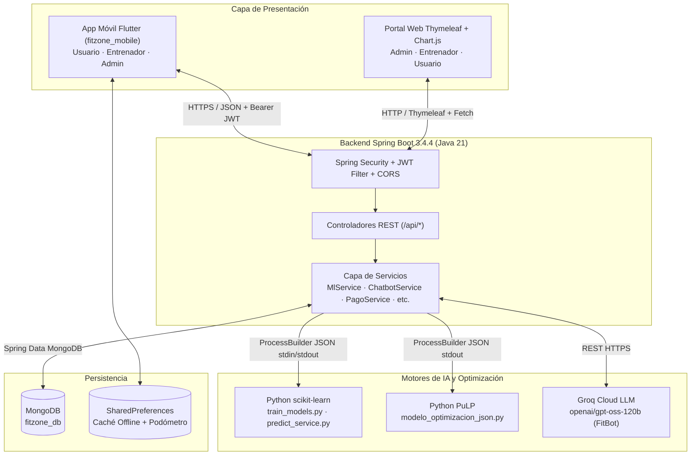
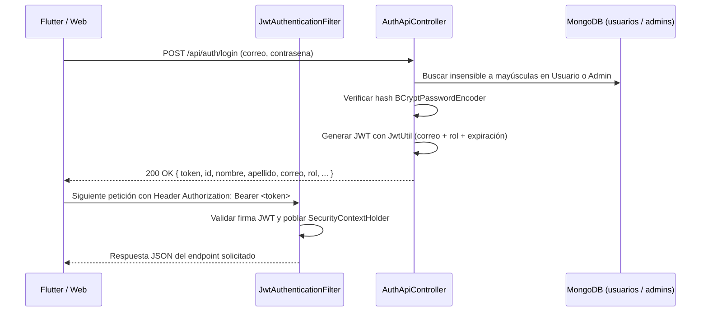

# Documentación Técnica Integral — Ecosistema FitZone (VIII Semestre)

Este documento consolida de extremo a extremo la arquitectura, API REST, base de datos, seguridad, modelos de Inteligencia Artificial / Minería de Datos II, aplicación Web y aplicación móvil en Flutter del proyecto **FitZone Fitness Club** (Ingeniería de Sistemas — Fundación Universitaria Tecnológico Comfenalco).

---

## 1. Visión General y Arquitectura del Sistema

**FitZone** es una plataforma integral de gestión inteligente para gimnasios compuesta por cuatro pilares articulados:

1. **Backend REST & Web (Spring Boot 3.4.4 / Java 21):** Expone la API REST stateless con JWT, sirve la interfaz web administrativa/operativa con Thymeleaf + Chart.js, orquesta los scripts de Python (ML y Optimización) y se conecta a **MongoDB** y **Groq LLM (FitBot)**.
2. **Minería de Datos II & Investigación de Operaciones (Python 3):** Pipeline predictivo de deserción (*Churn*) comparando 3 algoritmos supervisados (**Random Forest**, **Gradient Boosting**, **Red Neuronal MLP**), segmentación no supervisada (**K-Means k=3**) y asignación óptima de horarios/instructores mediante programación lineal entera (**PuLP**).
3. **Aplicación Móvil Multiplataforma (Flutter / Dart 3):** Cliente móvil (`fitzone_mobile`) con arquitectura en capas (`config`, `models`, `services`, `providers`, `widgets`, `screens`), 3 paneles diferenciados por rol (`USUARIO`, `ENTRENADOR`, `ADMIN`), **Podómetro en tiempo real por sensores**, **Modo Offline con caché persistente**, **Notificaciones Locales** y **gráficas interactivas (`fl_chart`)**.
4. **Infraestructura Cloud-Ready (Docker):** Contenedor multi-etapa (`Dockerfile`) que empaqueta Java 21 + entorno virtual Python 3 con todas las librerías de ML/PuLP, configurable mediante variables de entorno para Render, Railway o Azure + MongoDB Atlas.

### Diagrama de Arquitectura General

---

## 2. Stack Tecnológico y Estructura de Carpetas

### 2.1 Tecnologías Principales

| Capa | Tecnología / Librería | Versión / Rol |
|---|---|---|
| **Backend** | Java 21, Spring Boot (`web`, `security`, `data-mongodb`, `thymeleaf`, `mail`), `jjwt` | `3.4.4` / `0.11.5` (JWT stateless + BCrypt) |
| **Base de Datos** | MongoDB (Local `localhost:27017` / Cloud MongoDB Atlas) | `8.0` (`fitzone_db`) |
| **IA Conversacional** | Groq API (`openai/gpt-oss-120b` con fallbacks `gpt-oss-20b`, `qwen3.8-27b`) | Asistente **FitBot** contextualizado con `reglamento.txt` |
| **Minería de Datos II** | Python 3.11+, `scikit-learn`, `pandas`, `numpy`, `joblib`, Jupyter Notebook | Random Forest, Gradient Boosting, MLP, K-Means |
| **Optimización** | Python `PuLP` (Programación Lineal Entera Binaria) | Asignación óptima de instructores y clases |
| **Frontend Web** | HTML5, CSS3, JavaScript, Thymeleaf, Chart.js, SweetAlert2 | Paneles administrativos, gráficas ML y vistas públicas |
| **App Móvil** | Flutter / Dart SDK `^3.13.3` | `provider`, `http`, `shared_preferences`, `connectivity_plus`, `sensors_plus`, `flutter_local_notifications`, `timezone`, `fl_chart`, `intl` |
| **Contenedorización** | Docker Multi-Stage (`maven:3.9.9-eclipse-temurin-21` + `eclipse-temurin:21-jre-jammy`) | Empaquetado conjunto Java + Python venv |

### 2.2 Estructura de Directorios

- **Backend & ML (`Fitzonev9/`):**
  - `src/main/java/com/fitzone/fitzonev2/controller/` — 14 controladores REST y Web + `TokenStorage`.
  - `src/main/java/com/fitzone/fitzonev2/service/` — 9 servicios de lógica de negocio e integración IA.
  - `src/main/java/com/fitzone/fitzonev2/model/` — 9 entidades de dominio MongoDB.
  - `src/main/java/com/fitzone/fitzonev2/repository/` — 8 repositorios Spring Data MongoDB.
  - `src/main/java/com/fitzone/fitzonev2/dto/` — 5 DTOs de entrada/salida (`AuthRequest`, `ChatRequest`, `ChatResponse`, `ClaseRequest`, `PagoRequest`).
  - `src/main/java/com/fitzone/fitzonev2/security/` — Configuración JWT, filtro, CORS y `UserDetailsService`.
  - `src/main/resources/templates/` — 22 plantillas Thymeleaf (`admin/adminpanel.html`, `usuario/userpanel.html`, `entrenador/panelentrenador.html`, `fragments/chatbot.html`, etc.).
  - `ml/` — Scripts Python (`train_models.py`, `predict_service.py`), notebook (`analisis_predictivo_fitzone.ipynb`), dataset (`dataset_fitzone_churn.csv`), modelos serializados (`.joblib`) y métricas (`model_metrics.json`).
  - Raíz — `Dockerfile`, `requirements.txt`, `modelo_optimizacion_json.py`, `reglamento.txt`, `pom.xml`.
- **Aplicación Móvil (`fitzone_mobile/`):**
  - `lib/main.dart` — Punto de entrada, inyección de `MultiProvider` y enrutador de sesión (`_RootGate`).
  - `lib/config/` — `api_config.dart`, `app_theme.dart`.
  - `lib/models/` — `user_model.dart`, `gym_models.dart`, `ai_models.dart`.
  - `lib/services/` — `api_service.dart`, `offline_cache_service.dart`, `notification_service.dart`, `pedometer_service.dart`.
  - `lib/providers/` — `auth_provider.dart`, `gym_provider.dart`.
  - `lib/widgets/` — `ml_charts_section.dart`, `offline_banner.dart`, `success_check_dialog.dart`.
  - `lib/screens/` — 11 pantallas completas para autenticación, usuario, entrenador y administrador.

---

## 3. Configuración Cloud, Variables de Entorno y Docker

### 3.1 `application.properties`
El archivo `src/main/resources/application.properties` utiliza valores parametrizados con respaldo por defecto para alternar sin cambios de código entre desarrollo local y despliegue en la nube:

| Variable de Entorno | Propiedad Spring | Valor por Defecto | Propósito |
|---|---|---|---|
| `PORT` | `server.port` | `8080` | Puerto HTTP asignado por Render/Railway/Azure |
| `MONGODB_URI` | `spring.data.mongodb.uri` | `mongodb://localhost:27017/fitzone_db` | Cadena de conexión a MongoDB Atlas o local |
| `MONGODB_DATABASE` | `spring.data.mongodb.database` | `fitzone_db` | Nombre de la base de datos |
| `APP_BASE_URL` | `app.base-url` | `http://localhost:8080` | URL base pública para enlaces de verificación |
| `PYTHON_BIN` | `python.executable` | `python` (`/opt/venv/bin/python` en Docker) | Ruta del intérprete Python para ML y PuLP |
| `JWT_SECRET` | `jwt.secret` | Clave HMAC-SHA256 | Firma y validación de tokens JWT |
| `GROQ_API_KEY` | `groq.api.key` | *(inyectada en entorno)* | Credencial del API de Groq para FitBot |
| `GROQ_MODEL` | `groq.model` | `openai/gpt-oss-120b` | Modelo LLM principal de FitBot |
| `MAIL_USERNAME` / `MAIL_PASSWORD` | `spring.mail.*` | `fitzonegym.oficial@gmail.com` | Envío SMTP de verificación y recuperación |

### 3.2 `Dockerfile` Multi-Etapa
- **Etapa 1 (`build`):** Compila el `.jar` con Maven 3.9.9 y Temurin JDK 21 (`mvn -B clean package -DskipTests`).
- **Etapa 2 (`runtime`):** Imagen ligera `eclipse-temurin:21-jre-jammy`, instala Python 3, crea un entorno virtual `/opt/venv` con `requirements.txt`, copia `app.jar`, `ml/`, `modelo_optimizacion_json.py`, `reglamento.txt` y `dbfitzone/`, verifica los modelos entrenados ejecutando `train_models.py`, expone el puerto `8080` y define un `HEALTHCHECK` contra `/api/health`.

---

## 4. Seguridad, Autenticación y Control de Roles

### Flujo de Autenticación JWT

### Componentes Clave de Seguridad
- **`SecurityConfig.java`:** Configura CORS global (`allowedOriginPatterns("*")`, métodos `GET/POST/PUT/DELETE/PATCH/OPTIONS`, cabecera expuesta `Authorization`), desactiva CSRF, establece política `STATELESS`, registra `JwtAuthenticationFilter` y expone `AuthenticationManager` y `BCryptPasswordEncoder`.
- **`JwtUtil.java`:** Genera, firma (HMAC-SHA), extrae claims (`correo`, `rol`) y valida expiración de tokens JWT.
- **`JwtAuthenticationFilter.java`:** Intercepta cada petición, extrae `Authorization: Bearer ...`, maneja tokens inválidos sin romper endpoints públicos y carga el `UsuarioPrincipal` en el contexto de seguridad.
- **`CustomUserDetailsService.java`:** Resuelve cuentas desde `UsuarioRepository` o `AdminRepository`.

---

## 5. Modelo de Datos (MongoDB)

| Entidad (`model/`) | Repositorio (`repository/`) | Campos y Responsabilidad Principal |
|---|---|---|
| **Usuario** | `UsuarioRepository` | `id`, `nombre`, `apellido`, `correo`, `contrasena` (BCrypt), `rol` (`USUARIO`, `ENTRENADOR`, `ADMIN`), `peso`, `altura`, `objetivo`, `verificado`, `historialIMC` (`List<IMCRegistro>`). Incluye búsqueda `findFirstByCorreoIgnoreCase`. |
| **Admin** | `AdminRepository` | Credenciales administrativas dedicadas (`administracion@gimfitzone.com`) con soporte unificado en login JWT. |
| **Entrenador** | `EntrenadorRepository` | Información de instructores y asignación de disciplinas. |
| **Clase** | `ClaseRepository` | `id`, `nombreClase`, `descripcion`, `entrenadorId`, `entrenadorNombre`. Catálogo de clases grupales del gimnasio. |
| **Suscripcion** | `SuscripcionRepository` | Relación usuario ↔ clase reservada (`usuarioId`, `claseId`, fecha de reserva). |
| **Pago** | `PagoRepository` | `id`, `usuarioId`, `nombre`, `membresia` (Básico, Pro, Elite/VIP), `monto`, `fechaPago`, `fechaVencimiento`, `estado`. Control de membresía activa y facturación. |
| **Anuncio** | `AnuncioRepository` | `id`, `titulo`, `descripcion`, `fechaInicio`, `fechaFin`, `imagen`. Promociones y comunicados oficiales. |
| **IMCRegistro** | *(Embebido en Usuario)* | `peso`, `altura`, `imc`, `categoria`, `fecha`. Historial antropométrico del miembro. |
| **Encuesta** | `EncuestaRepository` | Registros históricos de comportamiento/satisfacción (`dbfitzone/fitzone_db.encuestas.json`) utilizados como base de datos para Minería de Datos II. |

---

## 6. Inventario Completo de la API REST y Controladores (Spring Boot)

### 6.1 Autenticación y Salud del Sistema

| Controlador | Método y Ruta | Descripción y Función Principal |
|---|---|---|
| `HealthController` | `GET /api/health` | Endpoint de monitoreo Cloud/Docker (`status: UP`, timestamp). Usado por Docker `HEALTHCHECK` y `ApiService.checkServerHealth()`. |
| `AuthApiController` | `POST /api/auth/login` | Valida correo (case-insensitive) y contraseña BCrypt en `Usuario` o `Admin`. Retorna JWT + perfil completo del usuario en una sola llamada. |
| `AuthApiController` | `POST /api/auth/register` | Crea un nuevo miembro (`USUARIO`), valida unicidad de correo, encripta contraseña con BCrypt, marca verificado y devuelve JWT inmediato. |
| `AuthApiController` | `GET /api/auth/me` | Devuelve los datos actualizados del usuario autenticado mediante el token `Bearer`. |
| `RegistroController` | `GET/POST /registro`, `GET /verificar`, `POST /reenviar-verificacion` | Flujo web tradicional de registro con envío de correo SMTP de verificación y almacenamiento temporal de tokens (`TokenStorage`). |

### 6.2 Gestión de Usuarios, Perfil e IMC

| Controlador | Método y Ruta | Descripción y Función Principal |
|---|---|---|
| `UsuarioController` | `GET /api/usuarios/{usuarioId}` | Obtiene el perfil completo de un usuario (incluyendo `historialIMC`). |
| `UsuarioController` | `PUT /api/usuarios/{usuarioId}/perfil` | Actualiza nombre, apellido, peso, altura y objetivo del miembro. |
| `UsuarioController` | `GET /api/usuarios/resumen?rol=&q=&limit=60` | **Endpoint optimizado móvil**: consulta paginada/proyectada con filtro por rol y búsqueda de texto, evitando descargar los +20,000 registros completos de MongoDB. |
| `UsuarioController` | `GET /api/usuarios/listar` | Listado general para consultas internas web. |
| `UsuarioController` | `POST /api/usuarios/agregar` | Crea usuarios desde el panel Admin (Web o Móvil). Acepta `contrasena` o `password`, normaliza correo a minúsculas, valida duplicados, aplica BCrypt y establece `verificado=true`. |
| `UsuarioController` | `PUT /api/usuarios/{usuarioId}/imc` | Agrega un nuevo cálculo de IMC al arreglo `historialIMC` del usuario. |
| `UsuarioController` | `DELETE /api/usuarios/{usuarioId}/imc` / `/{fecha}` | Elimina el historial de IMC completo o un registro puntual por fecha. |

### 6.3 Clases Grupales, Reservas, Pagos y Promociones

| Controlador | Método y Ruta | Descripción y Función Principal |
|---|---|---|
| `ClaseController` | `GET /api/clases/todas` | Lista todas las clases disponibles en FitZone. |
| `ClaseController` | `GET /api/clases/entrenador/{entrenadorId}` | Lista las clases impartidas por un entrenador específico. |
| `ClaseController` | `POST /api/clases` | Crea una nueva clase asignada al entrenador autenticado. |
| `ClaseController` | `DELETE /api/clases/{id}` | Elimina una clase del catálogo. |
| `SuscripcionController` | `POST /api/suscripciones` | Inscribe a un usuario en una clase (`usuarioId`, `claseId`). |
| `SuscripcionController` | `GET /api/suscripciones/usuario/{usuarioId}` | Lista las clases en las que está inscrito el usuario. |
| `SuscripcionController` | `DELETE /api/suscripciones/{usuarioId}/{claseId}` | Cancela la reserva del usuario en esa clase. |
| `PagoController` | `POST /api/pagos` | Registra un pago de membresía y calcula vigencia automática (30 días). |
| `PagoController` | `GET /api/pagos/usuario/{usuarioId}` | Devuelve historial completo de pagos del miembro. |
| `PagoController` | `GET /api/pagos/estado/{usuarioId}` | Devuelve el último pago y estado vigente de la membresía. |
| `AnuncioController` | `GET /api/anuncios/listar` | Obtiene promociones y anuncios vigentes. |
| `AnuncioController` | `POST /api/anuncios/agregar` | Crea anuncio multipart (JSON + imagen) desde Web Admin. |
| `AnuncioController` | `POST /api/anuncios/crear` | Crea anuncio JSON directo desde Flutter Admin. |
| `AnuncioController` | `GET /api/anuncios/imagen/{nombreImagen}` | Sirve archivos de imagen de anuncios desde disco. |
| `AnuncioController` | `DELETE /api/anuncios/eliminar/{id}` | Elimina una promoción publicada. |

### 6.4 Inteligencia Artificial, Minería de Datos II, Optimización y Administración

| Controlador | Método y Ruta | Descripción y Función Principal |
|---|---|---|
| `ChatbotController` | `POST /api/chatbot/message` | Envía el mensaje del usuario a `ChatbotService` (Groq LLM `openai/gpt-oss-120b` con fallback automático y contexto de `reglamento.txt`), limpia etiquetas `<think>` y devuelve `ChatResponse`. |
| `MlController` | `GET /api/ml/metrics` | Retorna `ml/model_metrics.json`: comparativa de los 3 modelos, curvas ROC-AUC, matriz de confusión, importancia de variables y segmentos K-Means. |
| `MlController` | `GET /api/ml/predict/all` | Ejecuta predicción masiva de abandono sobre perfiles de clientes con resumen de riesgo (`alto`, `medio`, `bajo`). Usa caché en memoria (5 min) en `MlService` para respuesta instantánea. |
| `MlController` | `POST /api/ml/predict/individual` | Evalúa en tiempo real el perfil de un miembro (asistencia, satisfacción, pagos, antigüedad) devolviendo probabilidad de abandono, nivel de riesgo, segmento K-Means y recomendaciones personalizadas. |
| `MlController` | `POST /api/ml/retrain` | Re-entrena `ml/train_models.py` en caliente y regenera artefactos `.joblib` y métricas. |
| `PredictController` | `GET /api/predict/cancelaciones` | Endpoint heredado compatible con la tabla web de predicciones. |
| `AdminController` | `GET /api/admin/estadisticas` | Consolida KPIs ejecutivos: total de usuarios, entrenadores, clases e ingresos acumulados. |
| `OptimizationController` | `GET /api/admin/optimize` | Ejecuta `modelo_optimizacion_json.py` (PuLP) mediante `ProcessBuilder` y devuelve la asignación óptima de instructores que minimiza el costo operativo. |
| `ControllerMain` | `GET /`, `/home`, `/login`, `/admin/adminpanel`, `/usuario/userpanel`, `/entrenador/panelentrenador`, `/promos`, `/membresias`, `/mis_clases`, etc. | Controlador MVC Thymeleaf para todas las vistas del portal web. |

---

## 7. Minería de Datos II y Optimización en Python

### 7.1 Pipeline Predictivo de Abandono y Segmentación (`ml/train_models.py`)
Construye un dataset de **800 registros** (`ml/dataset_fitzone_churn.csv`) combinando las encuestas reales de `dbfitzone/fitzone_db.encuestas.json` con aumento controlado de datos (*data augmentation*), 16 variables predictoras (8 numéricas estandarizadas con `StandardScaler` y 8 categóricas codificadas con `OneHotEncoder`) y partición estratificada **80% entrenamiento / 20% prueba** más **validación cruzada 5-Fold (`StratifiedKFold`)**:

| Algoritmo Evaluado | Accuracy | Precision | Recall | F1-Score | ROC-AUC | Estado |
|---|---:|---:|---:|---:|---:|---|
| **Random Forest** (`n_estimators=180, max_depth=8`) | **90.0%** | **90.3%** | **92.3%** | **91.3%** | **96.3%** | **Modelo Ganador (`best_churn_model.joblib`)** |
| **Red Neuronal (MLP)** (`48→24 ReLU`) | 86.9% | 90.7% | 85.7% | 88.1% | 93.7% | Evaluado |
| **Gradient Boosting** (`140 árboles, lr=0.07`) | 85.6% | 86.2% | 89.0% | 87.6% | 94.8% | Evaluado |

- **Matriz de Confusión (Random Forest sobre 160 pruebas):** `VN=60`, `FP=9`, `FN=7`, `VP=84`.
- **Importancia de Variables Top:** Satisfacción del servicio (`14.8%`), Frecuencia semanal (`13.1%`), Asistencia en la última semana (`10.4%` / `9.4%`), Ingresos mensuales (`9.3%`), Pagos atrasados (`7.3%`), Antigüedad (`4.6%`).
- **Segmentación No Supervisada (`K-Means, k=3`, `kmeans_model.joblib`):** *Silhouette Score* de **`0.3349`**, dividiendo automáticamente a la población en:
  1. **Atleta Comprometido** (`35.4%`, frecuencia prom. `4.54 d/sem`, tasa de cancelación `11.0%`).
  2. **Miembro Casual** (`35.1%`, frecuencia prom. `2.17 d/sem`, tasa de cancelación `66.5%`).
  3. **Miembro en Riesgo** (`29.5%`, baja asistencia / pagos atrasados, prioridad de retención).
- **Motor en Producción (`ml/predict_service.py`):** Lee JSON desde `stdin` (limpiando BOM UTF-8 en Windows), ejecuta inferencia con `best_churn_model.joblib` y `kmeans_model.joblib`, clasifica el riesgo (`ALTO`, `MEDIO`, `BAJO`) y genera recomendaciones accionables.
- **Notebook Científico (`ml/analisis_predictivo_fitzone.ipynb`):** Documento reproducible para Jupyter/Colab con exploración, tablas, barras comparativas, curvas ROC, matriz de confusión, importancia de variables y gráfica de dispersión K-Means.

### 7.2 Optimización de Horarios e Instructores (`modelo_optimizacion_json.py`)
Modelo de **Programación Lineal Entera Binaria** con **PuLP**:
- **Variables de decisión:** $x_{i,j} \in \{0, 1\}$ indicando si el instructor $i$ (`Carlos`, `Miguel`, `Ana`) dicta la disciplina $j$ (`Yoga`, `Crossfit`, `Spinning`, `Pilates`, `Zumba`, `Boxeo`).
- **Función objetivo:** Minimizar el costo total $\sum_{i,j} c_{i,j} \cdot d_j \cdot x_{i,j}$.
- **Restricciones:** Cada clase tiene exactamente un instructor asignado y ningún instructor excede su capacidad máxima semanal de horas.

### 7.3 Integración Web con Gráficas (`adminpanel.html`)
En `src/main/resources/templates/admin/adminpanel.html`, la función `cargarMetricasML()` consume `/api/ml/metrics` automáticamente al abrir la pestaña **Predicciones** y renderiza con **Chart.js**:
1. Gráfica de barras agrupadas comparando *Accuracy*, *F1-Score* y *ROC-AUC*.
2. Gráfica de líneas con las **Curvas ROC-AUC** de los 3 modelos frente a la línea base aleatoria.
3. Gráfica de barras horizontales de **Importancia de Variables**.
4. Gráfica de dona de **Segmentación K-Means (k=3)** + Matriz de Confusión 2×2 + tarjetas de perfil por clúster.

---

## 8. Aplicación Móvil Flutter (`fitzone_mobile`) — Desglose Completo

### 8.1 Arranque y Configuración Base

- **`lib/main.dart`:**
  - `main()`: Inicializa `WidgetsFlutterBinding`, carga la URL guardada en `ApiConfig.init()`, prepara `NotificationService().init()` y arranca `FitZoneApp`.
  - `FitZoneApp`: Registra el `MultiProvider` global (`ApiService`, `OfflineCacheService`, `AuthProvider`, `GymProvider`, `PedometerService`), configura `FitZoneApp.messengerKey`, aplica `AppTheme.darkTheme` y en pantallas anchas (>520px en navegador web) enmarca la app en un contenedor visual tipo teléfono móvil centrado.
  - `_RootGate`: Muestra pantalla de carga solo durante `auth.isInitializing` (nunca desmonta `LoginScreen` durante un intento de login); redirige automáticamente a `MainShell` si `auth.isAuthenticated` es verdadero o a `LoginScreen` en caso contrario.
- **`lib/config/api_config.dart`:**
  - Centraliza `baseUrl` (`http://localhost:8080` en web, `http://10.0.2.2:8080` en emulador Android, o URL pública HTTPS configurable desde el acceso oculto de 5 toques en Perfil).
- **`lib/config/app_theme.dart`:**
  - Define la identidad visual **Negro Mate (`#0D0D0F` / `#141417` / `#18181C`) + Blanco Limpio (`#F5F5F7`) + Carmesí Deportivo (`#D92638`)**, bordes sobrios (`#27272D`), tipografía jerárquica y estilos globales para `Card`, `InputDecoration`, `ElevatedButton`, `OutlinedButton`, `Chip`, `NavigationBar`, `Dialog` y `SnackBar`.

### 8.2 Modelos de Datos (`lib/models/`)

| Archivo | Clases | Propósito |
|---|---|---|
| `user_model.dart` | `UsuarioModel`, `ImcRegistroModel` | Serialización JSON del usuario, helpers de rol (`isAdmin`, `isEntrenador`, `nombreCompleto`) y registros históricos de IMC. |
| `gym_models.dart` | `ClaseModel`, `PagoModel`, `AnuncioModel`, `ChatMessageModel` | Clases grupales, membresías/pagos (incluyendo cálculo de días restantes y vigencia), promociones y mensajes del chat FitBot. |
| `ai_models.dart` | `MlPredictionModel`, `MlMetricsReport`, `ModelScore`, `ClusterSegment`, `FeatureImportance`, `RocPoint`, `ConfusionMatrixData`, `OptimizationResult`, `InstructorAssignment` | Parseo completo de predicciones individuales/masivas, métricas comparativas, curvas ROC, matriz de confusión, importancia de variables, segmentos K-Means y resultados PuLP. |

### 8.3 Servicios Avanzados (`lib/services/`)

1. **`api_service.dart`:**
   - Cliente HTTP centralizado con inyección automática de `Authorization: Bearer <token>`, timeouts controlados (`12s` estándar, `20–25s` IA/ML) y extractor amigable de errores (`_extractError`, `ApiException`).
   - Funciones principales: `checkServerHealth()`, `login()`, `register()`, `getUsuarioById()`, `actualizarPerfil()`, `getTodosUsuarios()` (usando `/api/usuarios/resumen`), `crearUsuarioAdmin()`, `registrarImc()`, `getTodasLasClases()`, `getClasesSuscritas()`, `suscribirseAClase()`, `desuscribirseDeClase()`, `crearClase()`, `getClasesDeEntrenador()`, `eliminarClase()`, `getEstadoPago()`, `getPagosUsuario()`, `registrarPago()`, `getAnuncios()`, `crearAnuncio()`, `eliminarAnuncio()`, `sendChatMessage()`, `getMlMetricsRaw()`, `predictIndividualRaw()`, `predictAllRaw()`, `getAdminStats()`, `runOptimization()`.
2. **`pedometer_service.dart`:**
   - **Podómetro en tiempo real por sensores (`sensors_plus`):** Escucha `userAccelerometerEventStream()`, calcula la magnitud vectorial $\sqrt{x^2 + y^2 + z^2}$ y detecta pasos con umbral (`> 2.2`) y ventana antirrebote (`320 ms`).
   - **Aislamiento total por usuario:** Persiste pasos diarios (`fitzone_steps_<userId>_YYYY_M_D`) y meta diaria (`fitzone_steps_goal_<userId>`) de forma independiente por cuenta (`initForUser()`, `resetSession()`, `setDailyGoal()`).
   - Calcula distancia (`distanceKm`), calorías (`caloriesKcal`), progreso (`0.0–1.0`), permite simulación (`addSimulatedSteps()`) en web/emulador y dispara `onGoalReached` al cumplir la meta diaria.
3. **`offline_cache_service.dart`:**
   - **Modo Offline:** Monitorea conectividad real con `connectivity_plus` (`onConnectivityChanged`, `hasNetwork()`).
   - Persiste en `SharedPreferences`: sesión JWT, perfil del usuario, catálogo de clases, mis reservas, anuncios, último pago, historial de pagos, historial de FitBot **aislado por `userId`** (`cache_fitbot_chat_<userId>`), métricas ML, última evaluación personal y marca temporal de última sincronización.
4. **`notification_service.dart`:**
   - Singleton sobre `flutter_local_notifications` + `timezone`.
   - Gestiona permisos de Android 13+ / iOS, envío inmediato (`showInstantNotification()` — metas cumplidas, recordatorios instantáneos) y programación diferida (`scheduleReminder()` con `zonedSchedule`). En Chrome Web realiza retorno seguro sin errores.

### 8.4 Gestión de Estado (`lib/providers/`)

- **`auth_provider.dart`:**
  - `init()`: Restaura sesión en caché sin bloquear el arranque y verifica conectividad en segundo plano.
  - `login()` y `register()` con soporte `deferNavigation: true` + `commitPendingSession()`: permite mostrar el diálogo de confirmación animada (`SuccessCheckDialog`) antes de navegar al panel principal.
  - `refreshProfile()`, `updateProfile()`, `checkConnectionNow()` y `logout()`.
- **`gym_provider.dart`:**
  - Orquesta carga inicial optimizada (`Future.wait`) diferenciada por rol: `loadInitialData()` (Usuario), `loadTrainerDashboard()` (Entrenador), `loadAdminDashboard()` (Admin).
  - Estrategia **Cache-First + Live Sync**: muestra datos locales al instante y actualiza desde Spring Boot; si no hay red, activa `usingOfflineData = true`.
  - Operaciones reactivas: `toggleSuscripcion()`, `crearClaseEntrenador()`, `eliminarClaseEntrenador()`, `registrarPagoSimulado()`, `registrarImc()`, `sendChatMessage()`, `clearChat()`, `loadMlMetrics()`, `runIndividualPrediction()`, `runOptimization()`, `crearUsuarioDesdeAdmin()`, `crearAnuncioAdmin()`, `eliminarAnuncioAdmin()` y `resetSessionState()` (limpieza total al cambiar de cuenta).

### 8.5 Widgets Reutilizables (`lib/widgets/`)

- **`ml_charts_section.dart`:** Renderiza 5 bloques gráficos interactivos con `fl_chart` en el panel de Administrador:
  1. Dona de distribución de riesgo de abandono (`PieChart`).
  2. Barras agrupadas comparando Random Forest, Gradient Boosting y MLP (`BarChart` con tooltips).
  3. Curvas ROC-AUC comparativas vs. diagonal aleatoria (`LineChart`).
  4. Dona de segmentación K-Means k=3 (`PieChart`).
  5. Barras de importancia de variables + cuadrícula 2×2 de Matriz de Confusión (`VN`, `FP`, `FN`, `VP`).
- **`offline_banner.dart`:** Barra discreta que informa cuando la app está mostrando datos locales sin conexión y muestra la hora de última sincronización.
- **`success_check_dialog.dart`:** Diálogo modal animado con check verde de confirmación al iniciar sesión o completar acciones clave.

### 8.6 Pantallas e Interfaces por Rol (`lib/screens/`)

#### Acceso y Navegación
- **`login_screen.dart`:** Fondo fotográfico oscuro atenuado (`login_bg.jpg`), logo oficial (`logo_oficial.png`), tarjeta oscura esmerilada (`BackdropFilter`), autocompletado nativo (`AutofillGroup`), opción **Recordar mis datos** (`SharedPreferences`), protección anti-doble-alerta al pulsar repetidamente, validación de correo/contraseña y navegación suave a registro.
- **`register_screen.dart`:** Formulario completo de registro de nuevos miembros (nombre, apellido, correo, contraseña, peso, altura, objetivo) con ingreso directo tras el registro.
- **`main_shell.dart`:** Contenedor principal con barra de navegación inferior (`NavigationBar`), AppBar con ícono dinámico según la pestaña activa, botón de perfil superior y carga automática del panel correspondiente al rol (`USUARIO`, `ENTRENADOR` o `ADMIN`).
- **`profile_screen.dart`:** Edición de datos personales, limpieza de caché offline y cierre de sesión limpio. **Separación inteligente por rol:** muestra Peso, Altura, Objetivo y **Meta diaria de pasos independiente por cuenta** únicamente para `USUARIO`, ocultándolos para `ADMIN` y `ENTRENADOR`. Incluye acceso técnico oculto (5 toques sobre la versión) para configurar la URL del servidor en la nube.

#### Panel de Usuario (`USUARIO` — 5 pestañas)
1. **Inicio (`home_screen.dart`):** Saludo personalizado, tarjeta de Pase de Membresía activa con días restantes, recordatorio de vencimiento (notificación local), selector modal de renovación de planes (Básico/Pro/Elite), accesos rápidos a FitBot y Coach IA, y carrusel de promociones vigentes.
2. **Clases (`classes_screen.dart`):** Selector segmentado (*Explorar* / *Mis reservas*), listado de clases grupales con inscripción y cancelación en un toque, y confirmación inmediata.
3. **Actividad (`activity_screen.dart`):** Podómetro en tiempo real con anillo de progreso, métricas de distancia/calorías/objetivo, botones Pausar/Reanudar y `+100 pasos`, recordatorios locales de entrenamiento, calculadora de **IMC** con barra de rangos e historial guardado en MongoDB.
4. **FitBot (`fitbot_screen.dart`):** Chat interactivo conectado a Groq LLM, sugerencias rápidas (*chips*), historial persistente aislado por cuenta y reinicio de conversación.
5. **Coach IA (`ai_analytics_screen.dart`):** Evaluador de constancia personal con controles deslizantes amigables (frecuencia semanal, satisfacción, meses activo, etc.) que consulta `/api/ml/predict/individual` y presenta el **Índice de Constancia**, ritmo actual y plan de acción en lenguaje 100% comprensible (sin jerga técnica).

#### Panel de Entrenador (`ENTRENADOR` — 4 pestañas, `trainer_screens.dart`)
1. **Panel Coach (`TrainerDashboardTab`):** Tarjeta de comando del entrenador, resumen de clases activas y alumnos, más accesos rápidos.
2. **Mis Clases (`TrainerClassesTab`):** Gestión completa de sus clases dictadas: crear nuevas disciplinas mediante diálogo modal y eliminar clases existentes.
3. **Alumnos (`TrainerStudentsTab`):** Directorio buscable de miembros con visualización de objetivos y seguimiento.
4. **FitBot (`FitbotScreen`):** Asistente IA de apoyo para rutinas y consultas operativas.

#### Panel de Administrador (`ADMIN` — 4 pestañas, `admin_screens.dart`)
1. **Resumen (`AdminDashboardTab`):** Tarjeta ejecutiva de ingresos acumulados, 3 cajas KPI diferenciadas por degradado (**Miembros** en carmesí oscuro, **Coaches** en ámbar oscuro, **Clases** en azul cobalto oscuro) y CRUD completo de **Promociones activas**.
2. **Usuarios (`AdminUsersTab`):** Búsqueda rápida y filtro por rol (`TODOS`, `USUARIO`, `ENTRENADOR`, `ADMIN`) sobre `/api/usuarios/resumen`, y creación directa de cuentas nuevas con validación y persistencia real en MongoDB.
3. **Analítica (`AdminAiAnalyticsTab`):** Radar de retención con conteo de riesgo Alto/Medio/Bajo, las **5 gráficas interactivas de `MlChartsSection`** (Dona de riesgo, Barras de modelos Python, Curvas ROC-AUC, Dona K-Means, Variables clave y Matriz de Confusión) y lista filtrable de miembros priorizados por riesgo de abandono.
4. **Horarios (`AdminOptimizationTab`):** Ejecución en vivo del optimizador PuLP (`/api/admin/optimize`), mostrando el costo operativo mínimo y la carga horaria óptima asignada a cada instructor.

---

## 9. Matriz Funcional por Rol y Cuentas de Prueba

| Funcionalidad | `USUARIO` | `ENTRENADOR` | `ADMIN` |
|---|:---:|:---:|:---:|
| Login JWT, recordar credenciales y Modo Offline | Sí | Sí | Sí |
| Pase de membresía, renovación y promociones | Ver / Renovar | Ver | Crear / Eliminar |
| Clases grupales y reservas | Reservar / Cancelar | Crear / Eliminar propias | Ver catálogo |
| Podómetro por sensores, meta diaria individual e IMC | Sí | Oculto (limpio) | Oculto (limpio) |
| Asistente IA FitBot (Groq LLM) con historial por cuenta | Sí | Sí | Portal Web |
| Coach IA personal (evaluación de constancia) | Sí | — | — |
| Directorio y creación de usuarios en BD | — | Ver alumnos | Crear / Filtrar |
| Radar de retención + Gráficas ML (Python / `fl_chart` / Chart.js) | — | — | Sí |
| Optimización de horarios e instructores (PuLP) | — | — | Sí |

### Credenciales de Prueba en Base de Datos Local
- **Administrador:** `administracion@gimfitzone.com` / `12345678`
- **Entrenador:** `carlos.entrena@example.com` / `12345678`
- **Usuario:** `stevenpc321@gmail.com` / `12345678`
